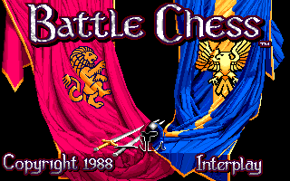
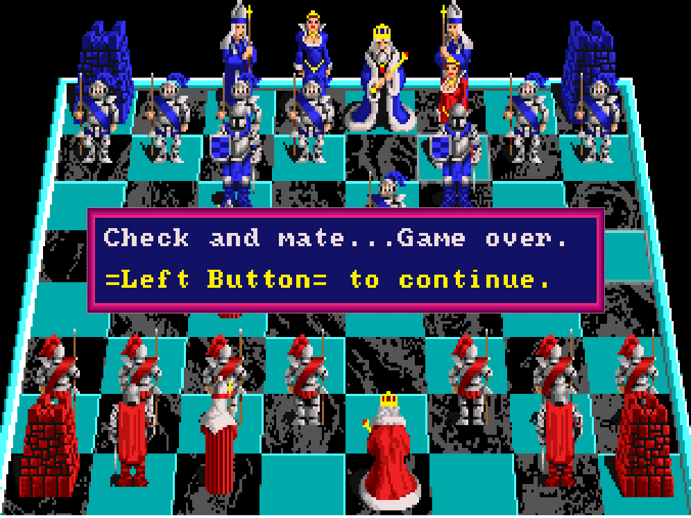

# BattleChess 2026

A restoration of the original Battle Chess for Windows and web browsers.
**Ivan Rogoz** originated this restoration effort:
[warped3.substack.com](https://warped3.substack.com).

Both editions include DOS and Amiga graphics, original walking and battle
animations, original sound effects, local two-player and computer play, save/load,
and the original-style game-over boxes. Amiga graphics are the default.
Checkmate ends at the final legal move, with both kings remaining on the board.

## Gameplay

This 51-second recording shows Amiga graphics, original sound, and a legal
checkmate with the original-style game-over message.

[Play or download the gameplay video (MP4)](recordings/battle-chess-amiga-game-over.mp4)

## Windows EXE edition

Extract **BattleChess 2026 Windows x64.zip**, keep the entire folder together,
and run `BattleChess.exe`. It uses the **system-installed WebView2 runtime**;
no browser runtime is bundled or downloaded. Python is included in the portable
package, so no Python installation is needed to play.

## HTML edition with external data

Extract **BattleChess 2026 HTML.zip**, keep the entire folder together, and open
`BattleChess.html` in your browser. **No web server, Python, or installation is
required to play.** Graphics, animation and sound data stay in external files.
Both sprite sets and the computer opponent work without HTTP asset requests.
Use Disk / Save Game and Load Game for portable JSON saves; automatic storage
of `file://` pages depends on the browser.

The original server-based edition remains in [web/](web/README.md).
Build instructions and checks are in [desktop/](desktop/README.md) and
[html/](html/README.md). Release packages and SHA256 checksums are in
[releases/2026/](releases/2026/RELEASE_NOTES.md).

Original Battle Chess: Interplay, 1988. This restoration uses the supplied
original resources; its chess engine and browser integration are native code.
